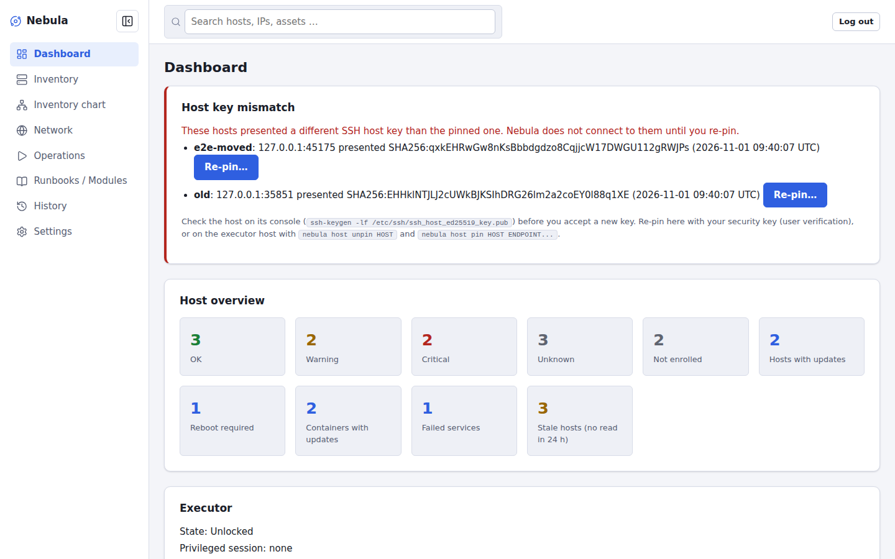
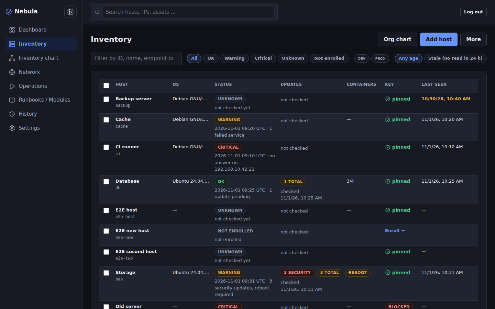
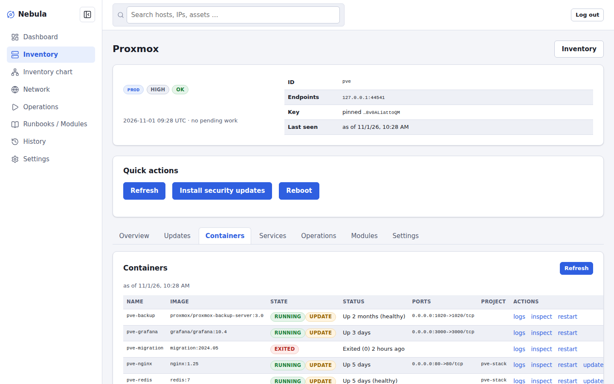
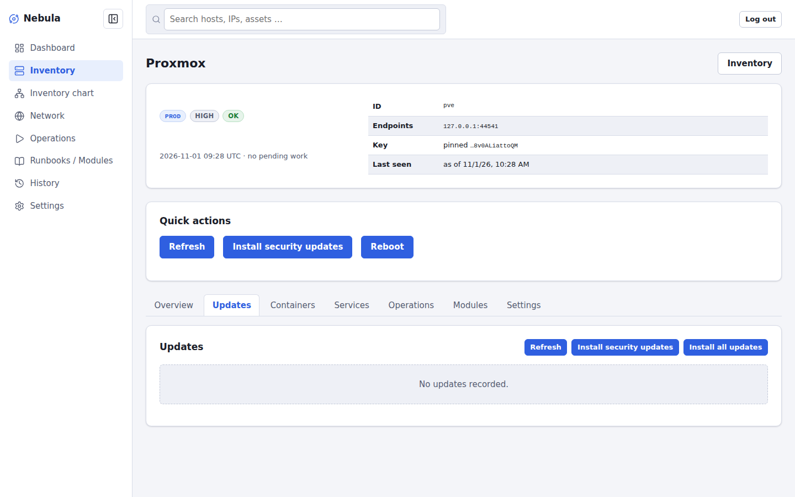
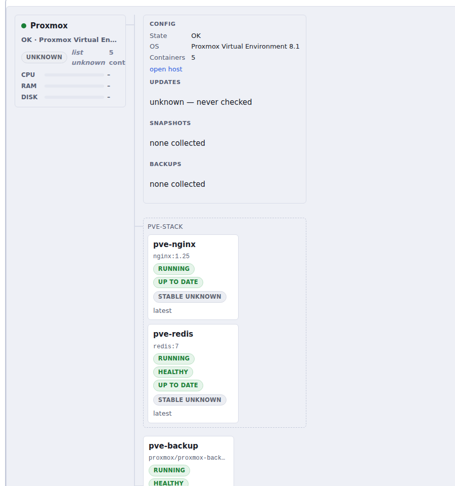
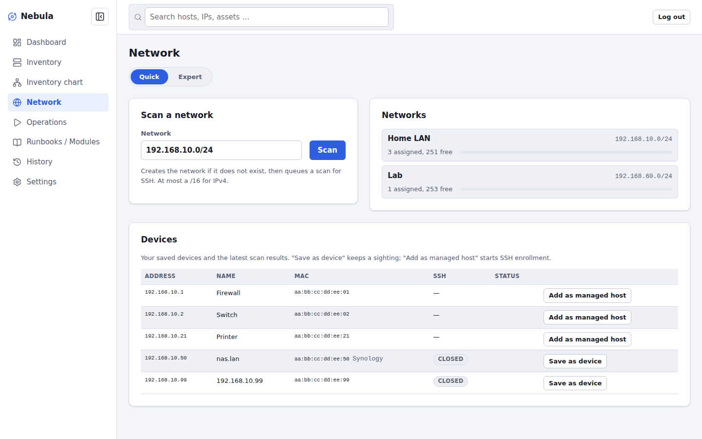

# Nebula Operation Station

A self-hosted operations control plane for Linux homelabs (about 5 to 100 hosts). It keeps an inventory of your hosts, Proxmox VE clusters, VMs and containers, patches and operates them over SSH, rolls changes out in stages and records every privileged action in a signed audit trail. Credentials live in a separate executor that checks every action on its own, so a compromised web server does not hand out your keys.

> **Status: alpha.** The code for Release 0.9 (inventory, patching, services, Docker, staged rollouts, runbooks, signed modules, IPAM, discovery, signed events, backup and restore, Debian packages and containers) is complete and passes the test suite; the lab run on real hosts is still pending. The Proxmox VE integration is in progress: the read path (nodes, guests, datastores, cluster) and the org chart are merged, live telemetry and VM actions are being built. Try it in a lab, not in production.

## What it does

- **Inventory and org chart.** Hosts, Proxmox nodes, VMs, LXC containers, Compose stacks and Docker containers in one tree, with patch state, container update status, datastores and their fill level, and a read-only details panel per box.
- **Patching and operations.** OS updates, service and container actions, reboots and your own runbooks, run agentless over SSH against pinned host keys.
- **Staged rollouts.** Plans run stage by stage with failure thresholds, postchecks and gates. A whole plan (for example twelve updates and three restarts) is approved once with a security key, and the executor still checks every member.
- **Proxmox VE.** Clusters and standalone hosts are added once with a least-privilege API token and a pinned TLS certificate; the executor reads them through bounded, approved read grants. See the [Proxmox operator guide](docs/operator/proxmox.md).
- **Network.** IPAM, discovery scans and device lists.
- **Audit and recovery.** Signed events, backup and restore with `age`, and release manifests signed with an offline hardware key ([release signing](docs/admin/release-signing.md)).

## Screenshots

Taken from the test harness's preview mode with demo data (`go run ./test/browser/harness -preview PORT /absolute/empty/dir`, then open `http://localhost:PORT`).

| Dashboard | Inventory (dark theme) |
| --- | --- |
|  |  |
| **Host: containers** | **Host: pending updates** |
|  |  |

Org chart: a host with its details panel, a Compose stack and standalone containers, each with running, health, same-tag and stable-version status:



Network, quick mode (scan, devices, usage):



On a phone: [inventory](docs/screenshots/inventory-phone-light.png). Light, dark or system theme under Settings → Appearance; the sidebar collapses to icons.

## How it is built

`nebula-server` serves the web UI and plans work but holds no keys and cannot execute anything. `nebula-executor` holds SSH keys and Proxmox tokens, listens only on a Unix socket, identifies callers by their kernel-reported UID, and authorizes each run against a permit bound to the exact artifact, targets, parameters and credentials that a human approved with WebAuthn (a YubiKey or another security key) or the `nebula` CLI. Standing read grants let routine reads (facts, updates, container and Proxmox status) run without a prompt each time, within a fixed scope, budget and expiry. Managed hosts need no agent. Details: [`docs/spec/00-index.md`](docs/spec/00-index.md), decisions in [`docs/adr/`](docs/adr/).

## Roadmap

| Area | State |
| --- | --- |
| Release 0.9 (milestones 0–10) | code complete; lab run on real hosts pending |
| Proxmox VE, phase 1 (read-only inventory, datastores, org chart) | read path and chart merged; live metrics, telemetry scheduling and collector packaging in progress ([ADR 0006](docs/adr/0006-proxmox-integration.md)) |
| Approval ergonomics (read grants, batch approval, sessions) | read grants, batch approval and stage gates merged; batch RPC, CLI and UI in progress ([ADR 0007](docs/adr/0007-approval-ergonomics.md)) |
| Proxmox VE, phase 2 (VM actions, OS and container updates from the chart) | planned |
| Guest provisioning (deploy profiles, cloud-init, bootstrap modules) | proposed; first-party bootstrap modules merged ([ADR 0008](docs/adr/0008-guest-provisioning.md)) |

## Repository layout

```
cmd/            nebula-server, nebula-executor, nebula-discovery, nebula-pve-collector, nebula (CLI)
internal/       implementation (no exported API)
modules/        first-party modules (bootstrap components)
proto/          executor RPC contract
docs/spec/      specification, one file per section
docs/adr/       architecture decision records
docs/admin/     installation, operations and release-signing handbooks
docs/operator/  integration guides (Proxmox VE)
test/security/  security acceptance tests
```

## Building and testing

```
make build             # static binaries in bin/
make check             # format, vet, staticcheck, buf lint, tests, govulncheck
sudo -E make test-privileged   # multi-UID security tests
```

Requires Go 1.26 or later and `buf` for code generation.

## Contributing

See [`CONTRIBUTING.md`](CONTRIBUTING.md) and the
[getting-started guide](docs/dev/getting-started.md) for the toolchain,
`make check`, the privileged tests and running the executor locally.

## License

AGPL-3.0-or-later. See [`LICENSE`](LICENSE).
