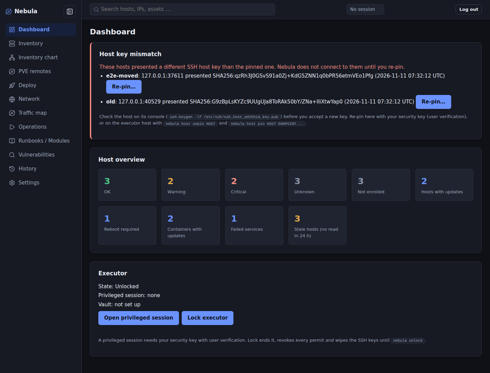
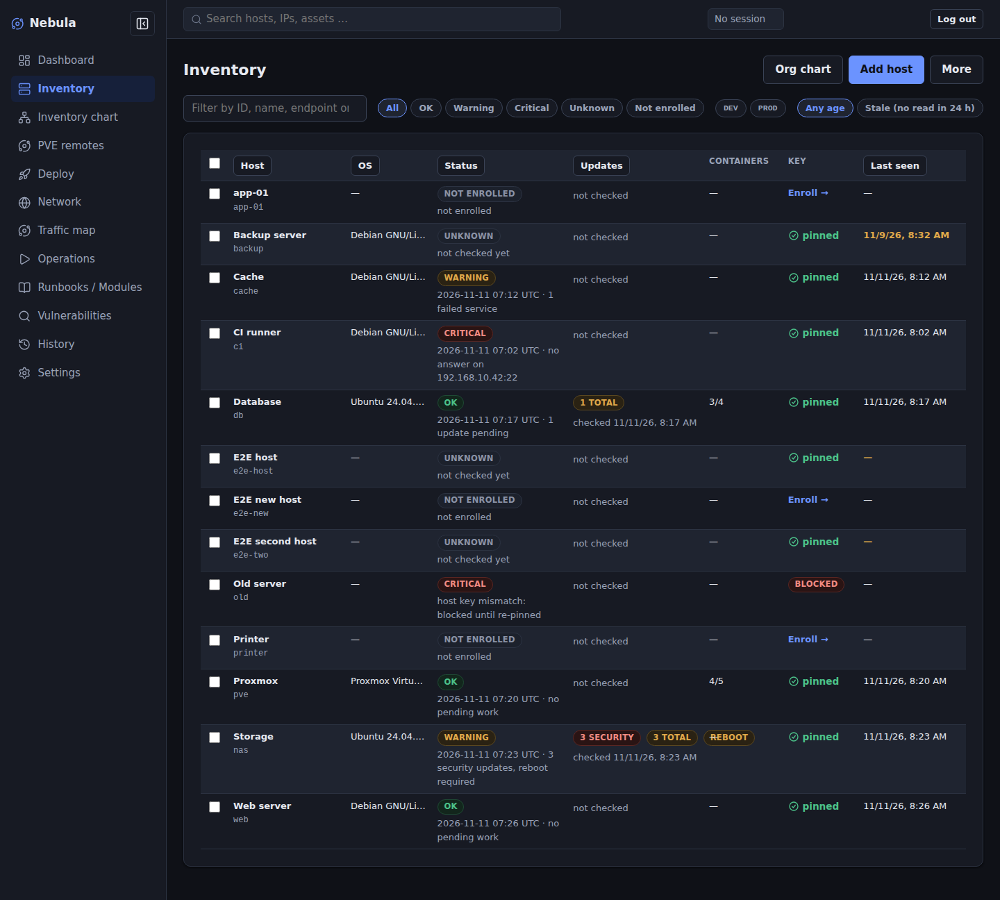
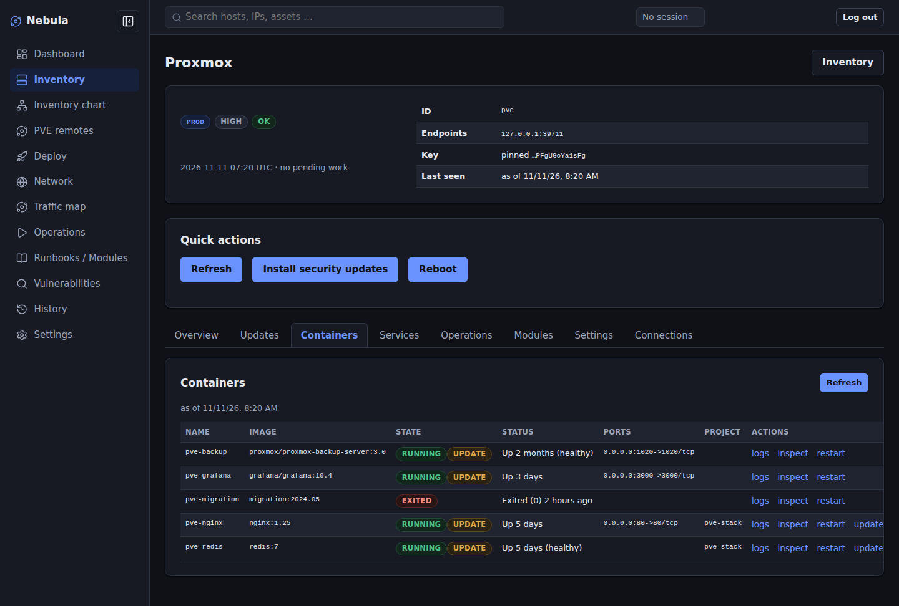
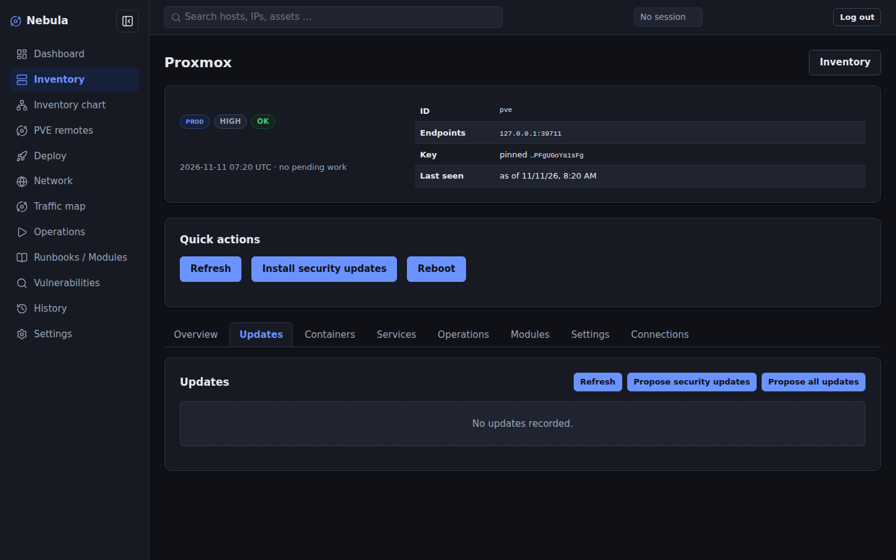
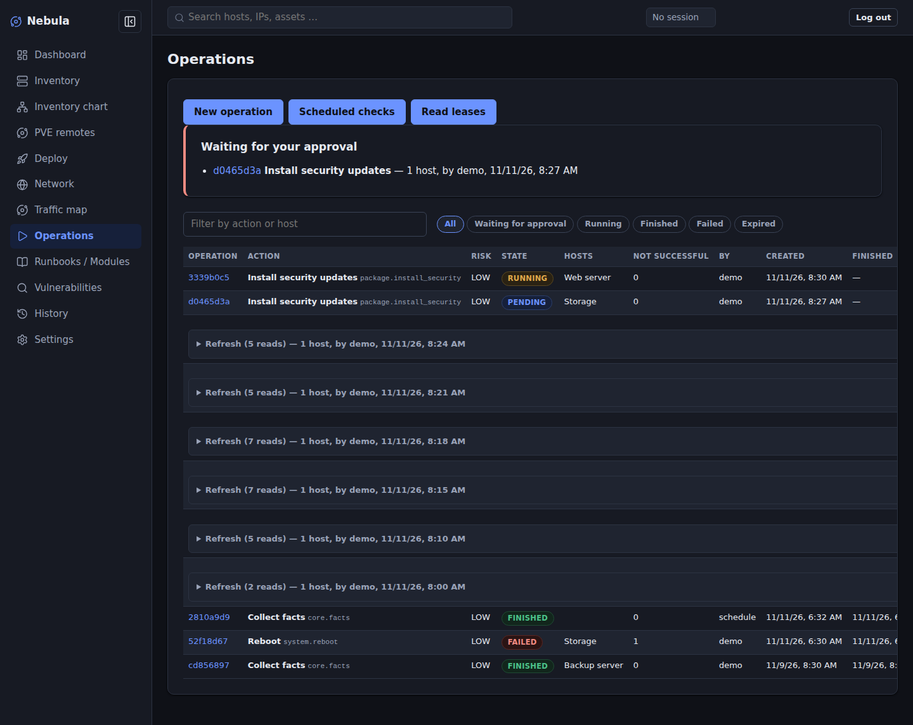
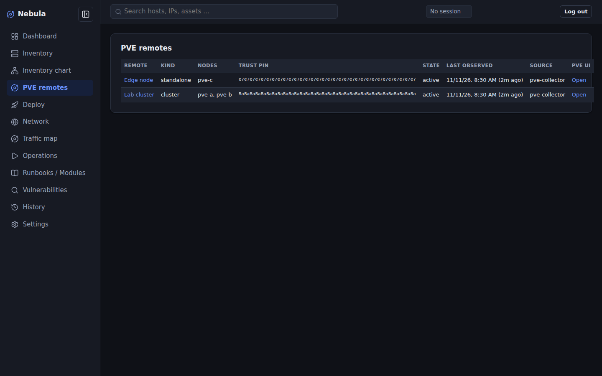
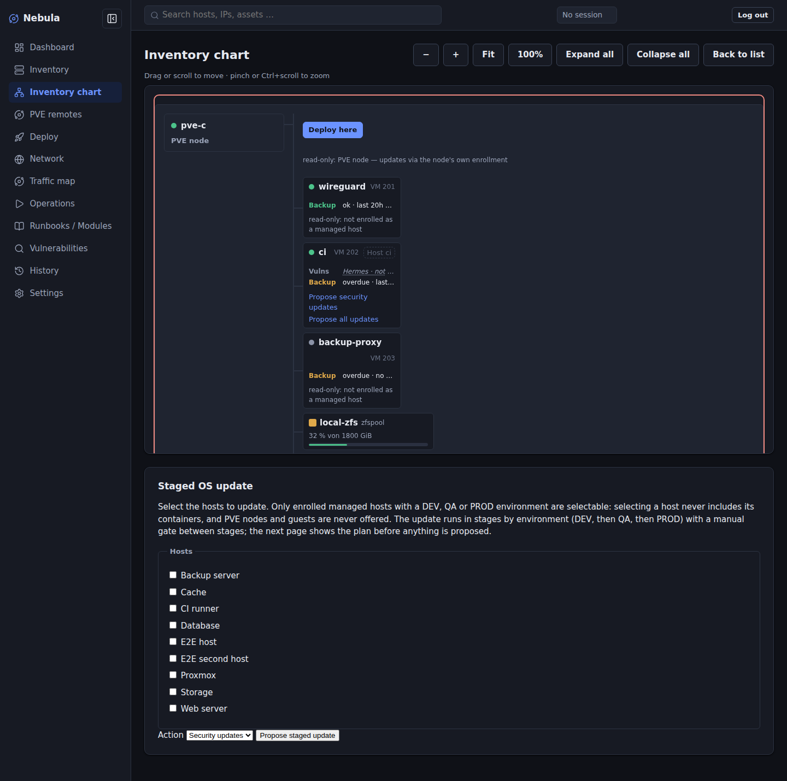
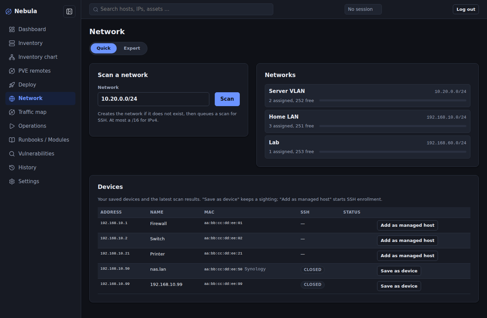
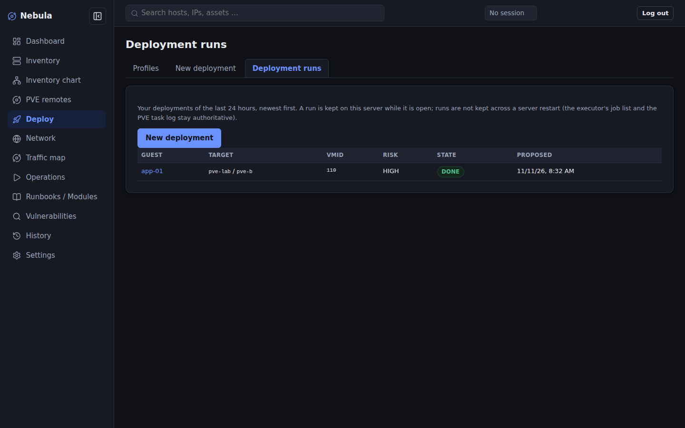
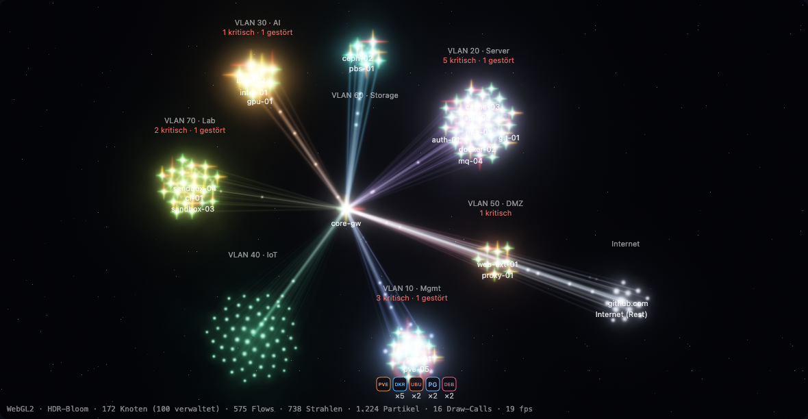

# Nebula Operation Station

A self-hosted operations control plane for Linux homelabs (about 5 to 100 hosts). It keeps an inventory of your hosts, Proxmox VE clusters, VMs and containers, patches and operates them over SSH, rolls changes out in stages and records every privileged action in a signed audit trail. Credentials live in a separate executor that checks every action on its own, so a compromised web server does not hand out your keys.

> **Status: alpha, 0.9 Beta in preparation.** The code for Release 0.9 (inventory, patching, services, Docker, staged rollouts, runbooks, signed modules, IPAM, discovery, signed events, backup and restore, Debian packages and containers) is complete and passes the test suite; the lab run on real hosts is still pending. Since then the Proxmox VE integration has grown into day-to-day operations, guest provisioning and batch approval are merged, the server side of vulnerability management is merged, and read-only support for network devices (Cisco CBS switches, Palo Alto firewalls) is being built. Try it in a lab, not in production.

## What it does

- **Inventory and org chart.** Hosts, Proxmox nodes, VMs, LXC containers, Compose stacks and Docker containers in one tree, with patch state, container update status, datastores and their fill level, live CPU, RAM and disk values, and a details panel per box.
- **Patching and operations.** OS updates, service and container actions, reboots and your own runbooks, run agentless over SSH against pinned host keys.
- **Staged rollouts.** Plans run stage by stage with failure thresholds, postchecks and gates. A whole plan (for example twelve updates and three restarts) is approved once with a security key, and the executor still checks every member.
- **Proxmox VE.** Clusters and standalone hosts are added once with a least-privilege API token and a pinned TLS certificate; the executor reads them through bounded, approved read grants. From the chart you can propose guest shutdown, reboot, stop and reset, snapshots (create, delete, rollback), a backup now, a migration within the cluster, a node reboot and OS updates; each is approved like any other change, with risk classes from MEDIUM to CRITICAL. See the [Proxmox operator guide](docs/operator/proxmox.md).
- **Guest provisioning.** Versioned deploy profiles with presets, a signed image catalog, cloud-init provisioning through a deploy wizard and enrollment of the new guest ([ADR 0008](docs/adr/0008-guest-provisioning.md)).
- **Network.** IPAM, discovery scans and device lists. Network devices (Cisco CBS switches, Palo Alto PAN-OS firewalls) are read with a dedicated read-only account through the executor: VLANs, ports, LLDP neighbours, zones, rules and hit counts, with a device inventory in the UI and a firewall view in progress ([ADR 0010](docs/adr/0010-network-devices.md)).
- **Vulnerability management.** CVE findings per host, container image and network device, prioritised by NOS (KEV, EPSS, CVSS, criticality) with attack paths; feeds are fetched and matched by a separate, minimal agent with fixed tools, never by the server ([ADR 0011](docs/adr/0011-vulnerability-management.md)). Advisory only: nothing here proposes or runs a change.
- **Audit and recovery.** Signed events, backup and restore with `age`, and release manifests signed with an offline hardware key ([release signing](docs/admin/release-signing.md)).

How-tos and a FAQ for running it: the [operator handbook](docs/handbook/README.md).

## Screenshots

Taken from the test harness's preview mode with demo data (`go run ./test/browser/harness -preview PORT /absolute/empty/dir`, then open `http://localhost:PORT`), dark theme.

| Dashboard | Inventory |
| --- | --- |
|  |  |
| **Host: containers** | **Host: pending updates** |
|  |  |
| **Operations** | **Proxmox VE remotes** |
|  |  |

Org chart: a Proxmox node with its guests (backup state, vulnerability summary, actions to propose security or all updates) and its datastore with fill level; below it the staged OS update across DEV, QA and PROD:



Network, quick mode (scan, devices, usage), and the deploy runs of guest provisioning:

| Network | Deploy runs |
| --- | --- |
|  |  |

On a phone: [inventory](docs/screenshots/inventory-phone-light.png). Light, dark or system theme under Settings → Appearance; the sidebar collapses to icons.

## Coming next: traffic map

A zoomable map of who talks to whom ([ADR 0009](https://github.com/nebula-operation-station/nebula-operation-station/pull/232), proposed). Zoomed out you see each VLAN and the traffic it sends through the router hop; closer in, the individual connections; a click on a host shows its top connections, and its inventory page lists every connection with peer, port, bytes and when it was last seen.



*Prototype with generated demo data for 100 hosts.* Hosts are stars sized by their assigned resources, connections are beams whose width and brightness follow the traffic volume (top 5 per host, 21 days of history), and the spikes of a star show patches, general health, disk and load. Software symbols appear as you zoom in: first per Proxmox host, then per guest, then the containers under Docker. The data comes agentlessly from read grants (neighbor tables, routes, VLANs, sockets) and the Proxmox collector; devices NOS sees but does not manage show up as unknown until you add them. Icons are only ever served by NOS itself after being re-encoded, never loaded from other sites. The parsers, the flow store, the software catalog, the icon pipeline and the WebGL2 renderer (with a Canvas 2D fallback) are merged; the API, the page and the connections tab are in progress.

## How it is built

`nebula-server` serves the web UI and plans work but holds no keys and cannot execute anything. `nebula-executor` holds SSH keys and Proxmox tokens, listens only on a Unix socket, identifies callers by their kernel-reported UID, and authorizes each run against a permit bound to the exact artifact, targets, parameters and credentials that a human approved with WebAuthn (a YubiKey or another security key) or the `nebula` CLI. Standing read grants let routine reads (facts, updates, container and Proxmox status) run without a prompt each time, within a fixed scope, budget and expiry. Managed hosts need no agent. Details: [`docs/spec/00-index.md`](docs/spec/00-index.md), decisions in [`docs/adr/`](docs/adr/).

## Roadmap

| Area | State |
| --- | --- |
| Release 0.9 (milestones 0–10) | code complete; lab run on real hosts pending; 0.9 Beta in preparation |
| Proxmox VE, phase 1 (read-only inventory, datastores, org chart, live values) | merged ([ADR 0006](docs/adr/0006-proxmox-integration.md)) |
| Proxmox VE, phase 2 (guest and node actions, updates from the chart) | guest power, snapshots, backup now, migration, node reboot and OS updates from the chart merged; follow-ups in progress |
| Approval ergonomics (read grants, batch approval, sessions) | merged ([ADR 0007](docs/adr/0007-approval-ergonomics.md)) |
| Guest provisioning (deploy profiles, image catalog, cloud-init, enrollment) | merged; preset host keys in progress ([ADR 0008](docs/adr/0008-guest-provisioning.md)) |
| Network devices, phase 1 (CBS and PAN-OS read path, collector, inventory, device pages) | collector, deployment, store and device pages merged; ingest, firewall view and IPAM/traffic-map integration in progress ([ADR 0010](docs/adr/0010-network-devices.md)) |
| Vulnerability management (findings, priority, attack paths, notifications) | server side merged; in-repo vulnerability agent in progress ([ADR 0011](docs/adr/0011-vulnerability-management.md)) |
| Network security advisor (reachability, rule and segmentation advice, firewall logs, IP reputation) | proposed (ADR 0012) |
| One-step host enrollment (pairing code, optional NetBird join) | proposed (ADR 0013) |
| Handbook, FAQ and in-app help | planned |
| Traffic map (communication map, observed endpoints, software symbols) | proposed; libraries, store, catalog, icon pipeline and renderer merged; API, page and connections tab in progress ([ADR 0009](https://github.com/nebula-operation-station/nebula-operation-station/pull/232)) |

## Repository layout

```
cmd/            nebula-server, nebula-executor, nebula-discovery, nebula-pve-collector, nebula-iconfetch, nebula (CLI)
internal/       implementation (no exported API)
modules/        first-party modules (bootstrap components)
proto/          executor RPC contract
web/            templates and static assets (no third-party code except vendored htmx and icons)
docs/spec/      specification, one file per section
docs/adr/       architecture decision records
docs/admin/     installation, operations and release-signing handbooks
docs/operator/  integration guides (Proxmox VE)
test/security/  security acceptance tests
```

## Building and testing

```
make build             # static binaries in bin/
make check             # format, vet, staticcheck, buf lint, tests, govulncheck
sudo -E make test-privileged   # multi-UID security tests
```

Requires Go 1.26 or later and `buf` for code generation.

## Contributing

See [`CONTRIBUTING.md`](CONTRIBUTING.md) and the
[getting-started guide](docs/dev/getting-started.md) for the toolchain,
`make check`, the privileged tests and running the executor locally.

## License

AGPL-3.0-or-later. See [`LICENSE`](LICENSE).
